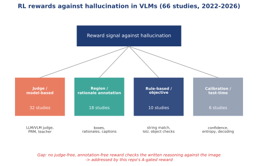
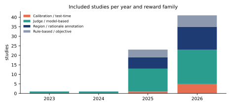
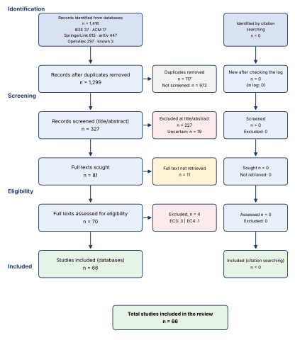
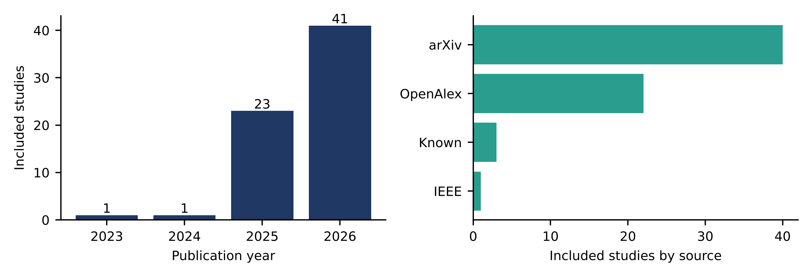
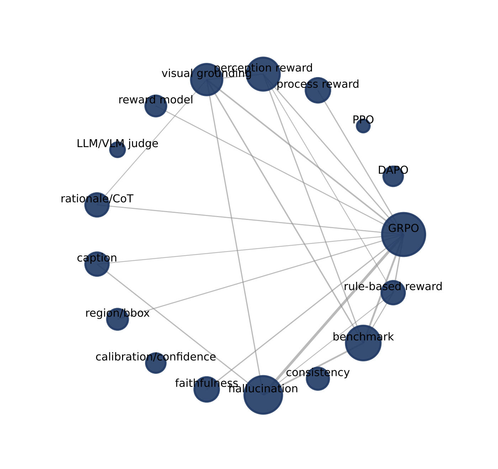
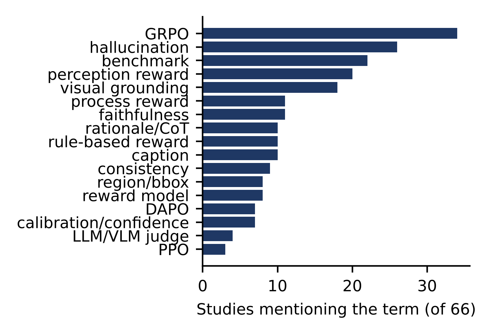
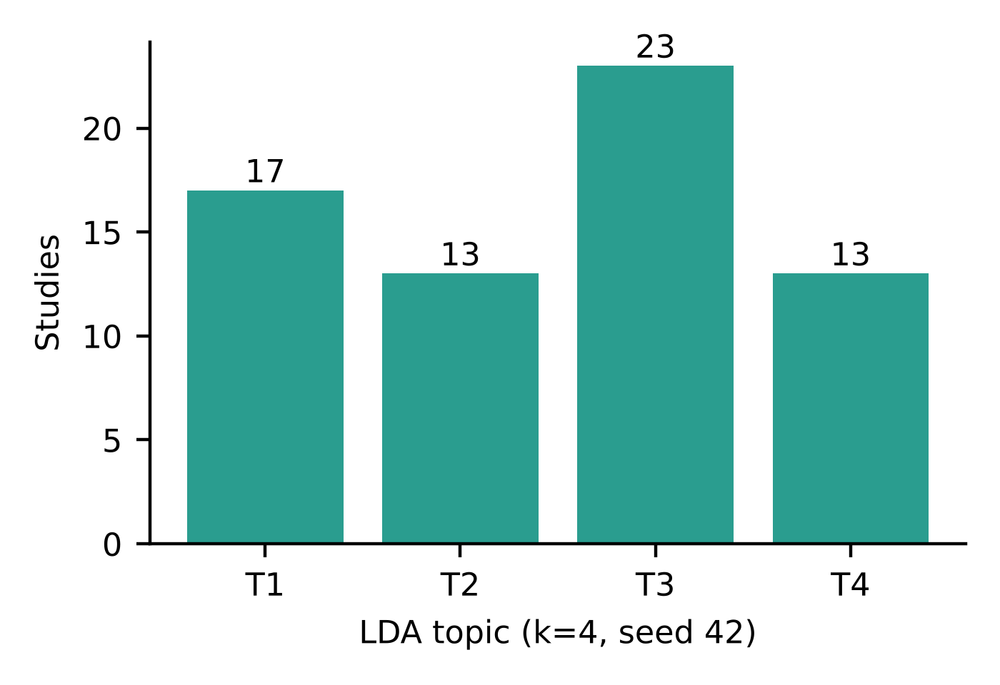
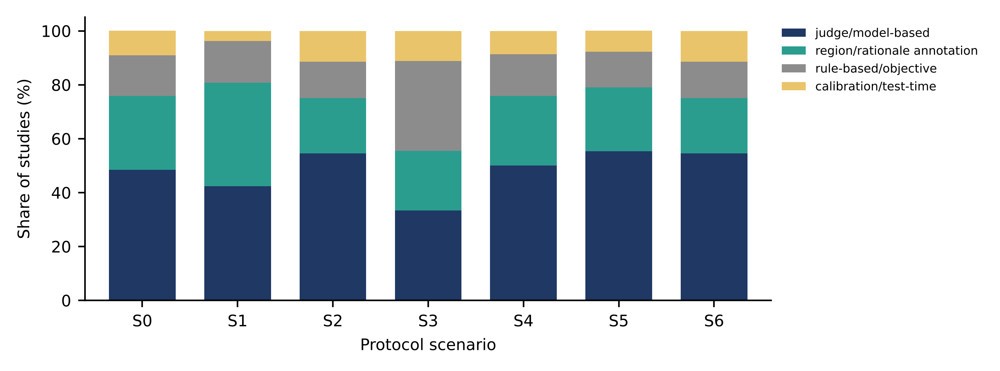
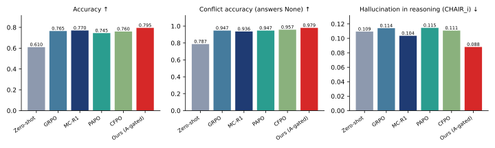
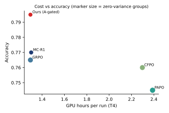

<div align="center">

# Process Hallucination in RL-Trained Vision-Language Models
### A systematic review of 66 studies, a curated paper list, and a judge-free, annotation-free consistency reward

[](#2--papers-by-reward-family)
[](data/SLR_workbook_327_screened_66_included.xlsx)
[](docs/Systematic_Review_Process_Hallucination_RLVR_VLMs.pdf)
[](index.html)
[](LICENSE)

</div>

Reinforcement learning with verifiable rewards (RLVR) makes vision-language models (VLMs) answer correctly more often, but a correct
final answer can sit on top of reasoning that describes things the image does not contain (**process hallucination**).
This repository collects the work on that problem, organises it by the kind of reward signal it uses, and adds our own
experiment: a lightweight reward that checks the written reasoning against the image without a judge model or human annotations.

## 🧭 Taxonomy: how the field fights process hallucination

<p align="center"></p>

**Reading the diagram.** Every included study was assigned to the reward family it relies on. Almost half need a judge or a
trained reward model; another quarter need region or rationale annotations. Rule-based checks are cheap but rarely look at the
reasoning text itself, which is the gap our method targets.

## 🆕 What's in this repo

| Folder | Content |
|---|---|
| [`docs/`](docs) | Full systematic review report (PDF/DOCX), research proposal |
| [`data/`](data) | Paper list (`papers.csv`, `papers.json`), screening and extraction workbook (327 records, 66 studies), BibTeX/RIS, sensitivity and keyword tables |
| [`code/notebooks/`](code/notebooks) | Colab/Kaggle notebooks: GRPO training with our reward, MC-R1, PAPO and CFPO re-implementations, ablation, comparison |
| [`code/bibliometrics/`](code/bibliometrics) | Bibliometric pipeline (trends, keyword network, LDA, sensitivity) and PRISMA figure script |
| [`results/part1/`](results/part1) | Raw results of the main experiment (registry, LaTeX tables, significance tests) |
| [`assets/`](assets) | All figures (SVG/PNG) |
| [`progressive_reports/`](progressive_reports) | Dated research log |
| [`index.html`](index.html) | Searchable, filterable table of all 66 papers (open locally or via GitHub Pages) |

### 📡 Trends
<p align="center"></p>

## Table of Contents
- [0. Citation](#0-citation)
- [1. Review protocol](#1--review-protocol)
- [2. Papers by reward family](#2--papers-by-reward-family)
  - [2.1. Calibration / test-time](#21-calibration--test-time-6-studies)
  - [2.2. Judge / model-based](#22-judge--model-based-32-studies)
  - [2.3. Region / rationale annotation](#23-region--rationale-annotation-18-studies)
  - [2.4. Rule-based / objective](#24-rule-based--objective-10-studies)
- [3. Bibliometrics and sensitivity](#3--bibliometrics-and-sensitivity)
- [4. Research gaps](#4--research-gaps)
- [5. Our method and experiment](#5--our-method-and-experiment)
- [6. Benchmarks used in the field](#6--benchmarks-used-in-the-field)
- [7. Contributing](#7-contributing)

## 0. Citation
If this collection or the review helps your work, please cite:
```bibtex
@misc{kazmi2026processhallucination,
  title  = {Process Hallucination in RL-Trained Vision-Language Models: A Systematic Review and a Judge-Free Consistency Reward},
  author = {Kazmi, Aafreen Zahra},
  year   = {2026},
  note   = {FAST-NUCES, MG 3010 Research Methodology. https://github.com/<your-username>/Awesome-Process-Hallucination-RLVR-VLMs}
}
```

## 1. 📐 Review protocol
- **Sources searched (8 Nov 2026):** arXiv, OpenAlex, SpringerLink, IEEE Xplore, ACM Digital Library; exact strings and hit counts in the workbook (`Search log` sheet).
- **Flow (PRISMA 2020):** 1,416 records identified → 327 unique records screened → **66 studies included**.
- **Quality assessment:** nine items (Q1–Q9) scored 1 / 0.5 / 0; 58 studies rated High, 8 Medium.
- **Limitations stated openly:** single screener (no inter-rater agreement yet), many preprints (arXiv/OpenAlex), quality scores for S45–S66 provisional.

<p align="center"></p>

## 2. 📚 Papers by reward family
Columns: study ID in the review, paper (linked), first author, year, venue, method, own code released, quality score.
Full extraction (dataset, evaluation, findings, limitations) is in [`data/papers.csv`](data/papers.csv) and the workbook.
> Reward families were assigned by keyword rules over each study's extracted method text (see `code/bibliometrics/analysis.py`), so a few borderline studies may fit another family better. Corrections are welcome via a pull request.

### 2.1. Calibration / test-time (6 studies)

| ID | Paper | First author | Year | Venue | Method (short) | Code | Quality |
|---|---|---|---|---|---|---|---|
| S10 | [SAVOR: Self-Aware Visual Grounding via Confidence-Calibrated Reinforcement Learning for Multimodal Hallucination Mitigation](https://arxiv.org/abs/2609.16601) | Ding Z. | 2026 | arXiv | Confidence-augmented outputs and a GRPO objective that penalises calibration error and poor abstention; confid… | - | 75% |
| S11 | [DEEPO: Dual-Entropy Enhanced Policy Optimization for Hallucination in MLLMs](https://arxiv.org/abs/2609.28570) | Zhuang Y. | 2026 | arXiv | Semantic-entropy-triggered expert prefixes plus advantage-sign-aware Renyi preconditioning. | - | 75% |
| S12 | [Staying VIGILant: Mitigating Visual Laziness via Counterfactual Visual Alignment in MLLMs](https://arxiv.org/abs/2606.26387) | Xiao X. | 2026 | ECCV | VIGIL: RL post-training that maximises visual-response mutual information and penalises blind confidence under… | - | 88% |
| S32 | [VL-Calibration: Decoupled Confidence Calibration for Large Vision-Language Models Reasoning](https://arxiv.org/abs/2604.09529) | Xiao W. | 2026 | ACL | Decoupled confidence calibration trained with RL (VL-Calibration). | Yes | 94% |
| S39 | [Teaching MLLMs to Say No: Generalized Referring Expression Comprehension via Refusal Calibrated GRPO](https://arxiv.org/abs/2608.04698) | Yang X. | 2026 | arXiv | Refusal-calibrated GRPO for generalized referring expression comprehension. | - | 69% |
| S56 | [MMBoundary: Advancing MLLM Knowledge Boundary Awareness through Reasoning Step Confidence Calibration](https://arxiv.org/abs/2505.23224) | He Z. | 2025 | ACL | Self-rewarding step-level confidence signals (textual and cross-modal), SFT warm-up for confidence expression,… | Yes | 100% |
### 2.2. Judge / model-based (32 studies)

| ID | Paper | First author | Year | Venue | Method (short) | Code | Quality |
|---|---|---|---|---|---|---|---|
| S02 | [Improving Vision-language Models with Perception-centric Process Reward Models](https://arxiv.org/abs/2604.24583) | Min Y. | 2026 | CVPR | Perceval: a trained process reward model that extracts image-related claims, checks each against the image and… | Yes | 88% |
| S03 | [CORA: Analyzing and bridging thinking-answer gap in Multimodal RLVR via Consistency-Oriented Reasoning Alignment](https://arxiv.org/abs/2606.14691) | Cao J. | 2026 | arXiv | Lightweight plug-and-play consistency reward model + Hybrid Reward Advantage Splitting (HRAS) in GRPO. | - | 88% |
| S05 | [CFPO: Counterfactual Policy Optimization for Multimodal Reasoning](https://arxiv.org/abs/2606.23206) | Yu Z. | 2026 | ICML | Cross-modal counterfactual regulariser: maximise the gap between predictions and a state with critical visual … | Yes | 94% |
| S09 | [V-Rubrics: Visual Faithfulness via Rubric-Based Reinforcement Learning](https://arxiv.org/abs/2608.25580) | Tian S. | 2026 | EMNLP | Atomic-proposition rubrics scoring Visual Faithfulness, Reasoning Consistency and Instruction Following; prefi… | - | 88% |
| S13 | [DRT: Dense Reasoning Trace for Efficient and Grounded Multimodal Reasoning](https://arxiv.org/abs/2609.21675) | Xu W. | 2026 | arXiv | Dense structured traces and Trace-Grounded GRPO with structured rewards. | - | 94% |
| S14 | [MIRL: Mutual Information-Guided Reinforcement Learning for Vision-Language Models](https://arxiv.org/abs/2605.01520) | Zhang Y. | 2026 | arXiv | Mutual-information-based selection of pre-sampled descriptions, forking, and decoupled perception/reasoning re… | - | 88% |
| S15 | [Visually-Guided Policy Optimization for Multimodal Reasoning](https://arxiv.org/abs/2604.09349) | Wang Z. | 2026 | ACL | VGPO: visual attention compensation and visual-focus reinforcement inside RLVR. | Yes | 100% |
| S27 | [V-tableR1: Process-Supervised Multimodal Table Reasoning with Critic-Guided Policy Optimization](https://arxiv.org/abs/2604.20755) | Jiang Y. | 2026 | arXiv | Process-supervised RL with a critic that scores reasoning steps (V-tableR1). | - | 75% |
| S30 | [AnE: Pushing the Reasoning Frontier of Multimodal LLMs via Anchor Evolution](https://arxiv.org/abs/2605.25571) | Wang Z. | 2026 | Springer | Anchor-and-explore RL (AnE) with truth-grounded anchors. | - | 75% |
| S31 | [Perceptual Flow Network for Visually Grounded Reasoning](https://arxiv.org/abs/2605.02730) | Li Y. | 2026 | ICML | Perceptual Flow Network: variational RL with multi-dimensional perception rewards, Qwen3-VL-8B base. | - | 81% |
| S33 | [Improving Visual Reasoning with Iterative Evidence Refinement](https://arxiv.org/abs/2603.14117) | Shi Z. | 2026 | arXiv | Iterative evidence refinement trained with GRPO (SIEVE) on Qwen3-VL-4B/8B. | - | 69% |
| S35 | [CPPO: Contrastive Perception Policy Optimization for VLM Agents](https://arxiv.org/abs/2601.00501) | Rezaei A. | 2026 | arXiv | Contrastive Perception Policy Optimization (CPPO). | Yes | 94% |
| S38 | [Think with Structured Grounding: Perceptual Reinforcement Learning for Chart and Visual-Tabular Understanding](https://arxiv.org/abs/2608.22429) | Jiang C. | 2026 | arXiv | Think with Structured Grounding: perceptual RL without external tools (TwSG). | - | 75% |
| S40 | [Consistency as Inductive Bias: Learning Cross-View Invariance for Robust Multimodal Reasoning](https://arxiv.org/abs/2606.29812) | Zou X. | 2026 | arXiv | ConsistRoll: cross-view consistency inside GRPO and Hint-GRPO, Qwen2.5-VL-7B and 3B. | Yes | 88% |
| S43 | [Reinforcing Multimodal Reasoning Against Visual Degradation](https://arxiv.org/abs/2605.09262) | Liu R. | 2026 | arXiv | RL that learns from successful trajectories under corrupted images, Qwen3-VL 4B/8B. | - | 75% |
| S45 | [Be Faithful When Response: Returning Fluent and Grounded Answers for Vision-Language Models Reinforcement Learning](https://arxiv.org/abs/2606.29984) | Gao P. | 2026 | arXiv | Faithful Warm-Start (FWS): build FaithfulQA by curating samples with explicit vision-language causal links fro… | - | 75% |
| S59 | [Understanding the Role of Hallucination in Reinforcement Post-Training of Multimodal Reasoning Models](https://arxiv.org/abs/2604.03179) | Zhang G. | 2026 | CVPR | Hallucination-as-Cue analysis: modality-specific corruptions that remove information needed for the answer, us… | - | 69% |
| S64 | [CAVE: A Structured Credit Assignment Approach for Fragmented Visual Evidence Reasoning](https://arxiv.org/abs/2605.16416) | Guo T. | 2026 | arXiv | Structured process reward on GRPO scoring belief update, evidence acquisition and adaptive focus control at th… | - | 88% |
| S04 | [More Than the Final Answer: Improving Visual Extraction and Logical Consistency in Vision-Language Models](https://arxiv.org/abs/2512.12487) | Just H.A. | 2025 | arXiv | PeRL-VL: VLM-based description reward scoring self-generated descriptions for faithfulness and sufficiency; te… | - | 88% |
| S18 | [Perception-Aware Policy Optimization for Multimodal Reasoning](https://arxiv.org/abs/2507.06448) | Wang Z. | 2025 | arXiv | PAPO: Implicit Perception Loss (KL term) plus Double Entropy Loss, plugged into GRPO/DAPO; no extra data, rewa… | - | 81% |
| S19 | [Vision-R1: Incentivizing Reasoning Capability in Multimodal Large Language Models](https://arxiv.org/abs/2503.06749) | Huang W. | 2025 | ICLR | Cold-start on a 200K multimodal CoT set, then GRPO with a hard-format result reward and Progressive Thinking S… | Yes | 88% |
| S21 | [SoTA with Less: MCTS-Guided Sample Selection for Data-Efficient Visual Reasoning Self-Improvement](https://arxiv.org/abs/2504.07934) | Wang X. | 2025 | NeurIPS | MCTS-measured difficulty selects 11K hard samples for RFT (no distillation). | Yes | 88% |
| S22 | [VisualPRM: An Effective Process Reward Model for Multimodal Reasoning](https://arxiv.org/abs/2503.10291) | Wang W. | 2025 | arXiv | 8B process reward model scoring steps, used for best-of-N selection; VisualPRM400K data and VisualProcessBench… | - | 88% |
| S25 | [A Survey of Multimodal Hallucination Evaluation and Detection](https://arxiv.org/abs/2507.19024) | Chen Z. | 2025 | Springer | Survey with a faithfulness/factuality taxonomy of hallucination, benchmarks and detection methods. | - | 75% |
| S36 | [ARM-Thinker: Reinforcing Multimodal Generative Reward Models with Agentic Tool Use and Visual Reasoning](https://arxiv.org/abs/2512.05111) | Ding S. | 2025 | arXiv | RL-trained agentic reward model that calls image tools to verify evidence (ARM-Thinker), Qwen2.5-VL-7B. | - | 69% |
| S46 | [Unveiling Chain of Step Reasoning for Vision-Language Models with Fine-grained Rewards](https://arxiv.org/abs/2509.19003) | Chen H. | 2025 | NeurIPS | Chain of Step (CoS) structured reasoning; ShareGPT-Step-300K with step labels from Monte Carlo estimation and … | Yes | 100% |
| S50 | [DeepEyes: Incentivizing "Thinking with Images" via Reinforcement Learning](https://arxiv.org/abs/2505.14362) | Zheng Z. | 2025 | ICLR | End-to-end agentic RL (no cold-start SFT) where the model calls its own grounding as an image-zoom tool; rewar… | Yes | 100% |
| S54 | [AutoRubric: Rubric-Based Generative Rewards for Faithful Multimodal Reasoning](https://arxiv.org/abs/2510.14738) | Jia M. | 2025 | arXiv | AutoRubric: self-aggregation of reasoning checkpoints from successful trajectories into problem-specific rubri… | - | 88% |
| S62 | [Qwen Look Again: Guiding Vision-Language Reasoning Models to Re-attention Visual Information](https://arxiv.org/abs/2505.23558) | Chu X. | 2025 | arXiv | Balanced Reflective Policy Optimization (BRPO) to decide when to reflect on the image; visual re-attention by … | Yes | 94% |
| S65 | [Learning When to Look: A Disentangled Curriculum for Strategic Perception in Multimodal Reasoning](https://arxiv.org/abs/2512.17227) | Yang S. | 2025 | arXiv | Disentangled SFT curriculum (text-only reasoning first, then perception-grounded CoT), then RL with a pivotal-… | Yes | 88% |
| S24 | [Hallucination of Multimodal Large Language Models: A Survey](https://arxiv.org/abs/2404.18930) | Bai Z. | 2024 | arXiv | Literature survey with taxonomy of causes, evaluation and mitigation. | Yes | 92% |
| S23 | [HallusionBench: An Advanced Diagnostic Suite for Entangled Language Hallucination and Visual Illusion in Large Vision-Language Models](https://arxiv.org/abs/2310.14566) | Guan T. | 2023 | CVPR | Human-crafted visual-question pairs with control groups. | Yes | 100% |
### 2.3. Region / rationale annotation (18 studies)

| ID | Paper | First author | Year | Venue | Method (short) | Code | Quality |
|---|---|---|---|---|---|---|---|
| S07 | [Attend to Evidence: Evidence-Anchored Spatial Attention Supervision for Multimodal RLVR](https://arxiv.org/abs/2605.30912) | Hu R. | 2026 | EMNLP | EASE: evidence-region annotations become a visual-token attention target used as process supervision on high-r… | Yes | 100% |
| S08 | [Faithful-MR1: Faithful Multimodal Reasoning via Anchoring and Reinforcing Visual Attention](https://arxiv.org/abs/2605.22072) | Tian C. | 2026 | arXiv | Anchoring (attention supervised against image regions) + Reinforcing (counterfactual image intervention reward… | - | 88% |
| S16 | [On Robustness and Chain-of-Thought Consistency of RL-Finetuned VLMs](https://arxiv.org/abs/2602.12506) | Zhao R. | 2026 | ICML | Controlled perturbation study (misleading captions, wrong CoT) on RL-finetuned and closed models. | - | 75% |
| S26 | [Metric-Driven Reinforcement Learning for Object Hallucination Reduction in LVLM-Based Image Captioning](https://doi.org/10.1109/ACCESS.2026.3723028) | Nguyen T. | 2026 | IEEE Access | Captioning as an MDP; Object Consistency Score (F1 of object precision and recall) as reward, token-level KL r… | - | 81% |
| S28 | [Where Do Long Captions Fail? Position-Aware Diagnosis and Reinforcement Learning for Detailed Image Captioning](https://arxiv.org/abs/2610.31111) | Hu Y. | 2026 | NeurIPS | Position-aware diagnosis and GRPO with a rubric-based reward (PAGER) on Qwen3-VL-4B. | - | 88% |
| S29 | [VCap: Hypergeometric Rewards for Weak-to-Strong Visual Captioning](https://arxiv.org/abs/2605.28023) | Lu X. | 2026 | arXiv | Witness-adjudicator reward with hypergeometric scoring for GRPO captioning (VCap), 8B model. | - | 75% |
| S37 | [Beyond Saying Less: Fine-Grained Alignment for Informative and Faithful Vision-Language Models](https://arxiv.org/abs/2609.35294) | Long X. | 2026 | arXiv | On-policy RL with fine-grained rewards against object hallucination. | - | 81% |
| S44 | [CGC: Compositional Grounded Contrast for Fine-Grained Multi-Image Understanding](https://arxiv.org/abs/2604.22498) | Zheng L. | 2026 | arXiv | Compositional Grounded Contrast (CGC): multi-image instances built from single-image grounding annotations plu… | - | 69% |
| S49 | [Difference Feedback: Generating Multimodal Process-Level Supervision for VLM Reinforcement Learning](https://arxiv.org/abs/2603.27482) | Feiding | 2026 | arXiv | Repair erroneous trajectories to build token/step-level masks (Difference Feedback), injected into GRPO (DF-GR… | - | 88% |
| S51 | [Ground What You See: Hallucination-Resistant MLLMs via Caption Feedback, Diversity-Aware Sampling, and Conflict Regularization](https://arxiv.org/abs/2601.06224) | Pan M. | 2026 | AAAI | Plan-and-caption stage with a quality-based caption reward; reward-variance-guided sample selection; NTK-based… | - | 69% |
| S53 | [Reinforcing Consistency in Video MLLMs with Structured Rewards](https://arxiv.org/abs/2604.01460) | Quan Y. | 2026 | arXiv | Compositional consistency audit, then sequence-level RL with a structured reward built from anchored factual a… | - | 69% |
| S58 | [Saliency-R1: Enforcing Interpretable and Faithful Vision-language Reasoning via Saliency-map Alignment Reward](https://arxiv.org/abs/2604.04500) | Gong S. | 2026 | CVPR | Token-level saliency maps via logits decomposition; reward = overlap between saliency and human-annotated boxe… | Yes | 100% |
| S17 | [Perception-R1: Advancing Multimodal Reasoning Capabilities of MLLMs via Visual Perception Reward](https://arxiv.org/abs/2506.07218) | Xiao T. | 2025 | arXiv | Visual perception reward: a judging LLM scores consistency between visual annotations taken from CoT trajector… | Yes | 94% |
| S52 | [PROPA: Toward Process-level Optimization in Visual Reasoning via Reinforcement Learning](https://arxiv.org/abs/2511.10279) | Jiang Y. | 2025 | arXiv | MCTS-guided GRPO producing dense step-level rewards without annotation, interleaved with SFT to fix cold start… | Yes | 88% |
| S57 | [DeFacto: Counterfactual Thinking with Images for Enforcing Evidence-Grounded and Faithful Reasoning](https://arxiv.org/abs/2509.20912) | Xu T. | 2025 | arXiv | Positive, counterfactual and random-masking training; language-guided evidence region construction (DeFacto-10… | Yes | 81% |
| S60 | [CodeV: Code with Images for Faithful Visual Reasoning via Tool-Aware Policy Optimization](https://arxiv.org/abs/2511.19661) | Hou X. | 2025 | arXiv | Faithfulness protocol that checks whether visual tool outputs contain the queried evidence; Tool-Aware Policy … | Yes | 94% |
| S63 | [From Illusion to Intention: Visual Rationale Learning for Vision-Language Reasoning](https://arxiv.org/abs/2511.23031) | Wang C. | 2025 | arXiv | Visual Rationale Learning (ViRL): process supervision with ground-truth rationales, step-level reward shaping,… | - | 81% |
| S66 | [Reasoning-Aligned Perception Decoupling for Scalable Multi-modal Reasoning](https://arxiv.org/abs/2506.04559) | Gou Y. | 2025 | ICLR | RAPID decouples perception (MLLM writes detailed captions) from reasoning (external text-only LLM); Visual Per… | Yes | 100% |
### 2.4. Rule-based / objective (10 studies)

| ID | Paper | First author | Year | Venue | Method (short) | Code | Quality |
|---|---|---|---|---|---|---|---|
| S01 | [PaLMR: Towards Faithful Visual Reasoning via Multimodal Process Alignment](https://arxiv.org/abs/2603.06652) | Li Y. | 2026 | CVPR | Perception-aligned data layer (pseudo ground truth + verifiable visual facts) and process-aligned optimisation… | - | 88% |
| S34 | [Addressing Overthinking in Large Vision-Language Models via Gated Perception-Reasoning Optimization](https://arxiv.org/abs/2601.04442) | Diao X. | 2026 | ACL | Perception-aware RL objective (GPRO). | - | 81% |
| S41 | [Iterative Visual Thinking and the Self-Correction Mirage in VLM Grounding](https://arxiv.org/abs/2606.13156) | Tripathy A. | 2026 | arXiv | Analysis of GRPO with an IoU reward and label-free stopping rules, Qwen3-VL-4B. | - | 81% |
| S42 | [Reinforcement Learning with Robust Rubric Rewards](https://arxiv.org/abs/2605.30244) | Yu Y.-Q. | 2026 | EMNLP | Reinforcement learning with robust rubric rewards (RLR3), deterministic verification of rubrics generated by f… | - | 88% |
| S47 | [PerceptRL: Making Visual Perception Rewardable in MLLMs from Answers to Interactions](https://arxiv.org/abs/2610.37471) | Guan T. | 2026 | arXiv | Perception RL: extract verified errors from dense captions and convert them into QA pairs with fixed labels an… | - | 75% |
| S55 | [SCOUT: Unlocking Enhanced Spatial Reasoning via Structured Chain-of-Thought and Multi-Objective Process Reward](https://arxiv.org/abs/2608.12220) | Zhou Z. | 2026 | arXiv | Structured CoT that models 3D perception, multi-objective process rewards and segment-wise advantage estimatio… | - | 88% |
| S06 | [COPO: Causal-Oriented Policy Optimization for Hallucinations of MLLMs](https://arxiv.org/abs/2508.04182) | Guo P. | 2025 | arXiv | Token-level causal-completeness reward and a causally informed advantage inside GRPO. | - | 62% |
| S20 | [Visual-RFT: Visual Reinforcement Fine-Tuning](https://arxiv.org/abs/2503.01785) | Liu Z. | 2025 | ICCV | Verifiable perception rewards (e.g. IoU for detection) with GRPO for LVLMs. | Yes | 88% |
| S48 | [ViCrit: A Verifiable Reinforcement Learning Proxy Task for Visual Perception in VLMs](https://arxiv.org/abs/2506.10128) | Wang X. | 2025 | arXiv | Proxy task: inject one subtle synthetic error into a 200-word human caption and train the VLM to localise the … | Yes | 81% |
| S61 | [Perceptual-Evidence Anchored Reinforced Learning for Multimodal Reasoning](https://arxiv.org/abs/2511.18437) | Zhang C. | 2025 | arXiv | PEARL: derive a perception checklist of verifiable sub-questions per item; auxiliary perception rollouts give … | Yes | 94% |

## 3. 📊 Bibliometrics and sensitivity
<p align="center">
 <br>
 
</p>

**Sensitivity analysis.** The headline finding (judge/model-based rewards dominate) holds in every protocol variant except the 9 verified peer-reviewed studies.

| Scenario | Studies | Mean quality | Top reward family |
|---|---|---|---|
| S0 baseline (all 66) | 66 | 84.5% | judge/model-based |
| S1 drop arXiv-sourced studies | 26 | 87.0% | judge/model-based |
| S2 drop OpenAlex-sourced studies | 44 | 83.5% | judge/model-based |
| S3 peer-reviewed verified only | 9 | 88.9% | rule-based/objective |
| S4 QA threshold >= 75% | 58 | 86.8% | judge/model-based |
| S5 QA threshold >= 88% | 38 | 91.6% | judge/model-based |
| S6 exclude provisional S45-S66 | 44 | 83.5% | judge/model-based |

<p align="center"></p>

## 4. 🕳️ Research gaps
| ID | Gap | Evidence (study IDs) |
|---|---|---|
| G1 | Judge-free methods (attention or perception regularisers, auxiliary perception tasks) do not check whether the written reasoning matches the image | S05, S12, S18, S34, S35, S47, S48, S61 |
| G2 | Methods that do check the reasoning depend on a judge, annotations, rubrics or a trained reward model | S02, S04, S07, S08, S09, S17, S37, S42, S46, S54, S60 |
| G3 | No study compares reward families on one backbone with training cost reported | backbones, data and benchmarks differ across papers |
| G4 | Small scale or one model family; weak reproducibility (own code in 25 of 66) | S03, S18, S38, S41, S50, S55 |
| G5 | Accuracy gains do not prove the image was used; reasoning can be fragile | S16, S29, S41, S43, S59 |

## 5. 🧪 Our method and experiment
**A-gated (starvation-gated consistency reward).** Reward A = Q · (w<sub>c</sub>·C + w<sub>g</sub>·G):
**C** checks that the reasoning agrees with the final answer about the asked object, **G** lets a frozen CLIP verify the objects the
reasoning claims to see, **Q** blocks empty, copied or repetitive reasoning. A is given **only in GRPO groups whose outcome reward has
zero variance**, i.e. exactly where plain GRPO gets no gradient. No judge model and no annotations are used inside the reward.

**Setup.** Qwen2.5-VL-3B-Instruct, LoRA, GRPO (TRL), 40 steps, 2,000 COCO-based modality-conflict questions (absent object → answer *None*),
200 held-out questions with an unseen phrasing, seed 42, one Kaggle T4. Baselines re-implemented on the same budget:
[MC-R1](https://doi.org/10.1109/TMM.2026.3726309) (IEEE TMM 2026), [PAPO](https://arxiv.org/abs/2507.06448) (ICLR 2026), [CFPO](https://arxiv.org/abs/2606.23206).

| Method | Acc ↑ | Conflict acc ↑ | Normal acc ↑ | False-None ↓ | CHAIR_i ↓ | CHAIR_s ↓ | Zero-var groups ↓ | GPU h | Peak GB |
|---|---|---|---|---|---|---|---|---|---|
| Zero-shot | 0.610 | 0.787 | 0.453 | 0.057 | 0.109 | 0.175 | – | – | – |
| GRPO | 0.765 | 0.947 | 0.604 | 0.066 | 0.114 | 0.170 | 0.150 | 1.30 | 3.1 |
| MC-R1 | 0.770 | 0.936 | 0.623 | 0.066 | 0.104 | 0.150 | 0.050 | 1.30 | 4.0 |
| PAPO | 0.745 | 0.947 | 0.566 | 0.104 | 0.115 | 0.180 | 0.175 | 2.39 | 8.0 |
| CFPO | 0.760 | 0.957 | 0.585 | 0.094 | 0.111 | 0.165 | 0.150 | 2.30 | 8.0 |
| **Ours (A-gated)** | **0.795** | 0.979 | 0.632 | 0.104 | **0.088** | 0.130 | 0.037 | 1.30 | 3.9 |

<p align="center"></p>
<p align="center"></p>

- Every trained method beats zero-shot significantly (exact McNemar, Holm-adjusted; ours +18.5 points, 95% CI [12.5, 24.5]).
- Ours has the highest accuracy and the lowest hallucination inside the reasoning, at the training cost of plain GRPO; PAPO and CFPO need about 1.8× the time and 2× the memory.
- **Honest caveats:** one seed and 200 test items, so the differences between trained methods are not yet statistically confirmed; ours raises the false-None rate (0.066 → 0.104). Larger runs are in progress.

## 6. 🗂️ Benchmarks used in the field
POPE, CHAIR (COCO), HallusionBench, MMHal-Bench, AMBER, MMStar, MMMU, MathVista, MMMC (modality conflict). Our experiment uses a
COCO modality-conflict set, POPE, and a reasoning-level CHAIR variant; MMMC and an Urdu re-phrased set are supported in the notebooks.

## 7. Contributing
New paper on rewards against hallucination in RL-trained VLMs? Open an issue or a pull request that adds a row to
[`data/papers.csv`](data/papers.csv) (title, first author, year, venue, link, reward family) and run `python build_site.py`.
See [CONTRIBUTING.md](CONTRIBUTING.md).

---
Maintained by **Aafreen Zahra Kazmi** (FAST-NUCES). Code under MIT, text and data under CC BY 4.0 (see [LICENSE](LICENSE)).
Datasets (COCO, POPE, MMMC, MVTec AD) keep their own licences and are downloaded by the notebooks, not redistributed here.
